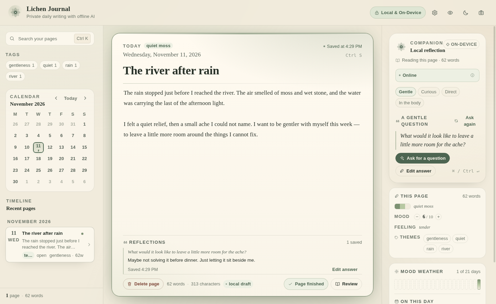
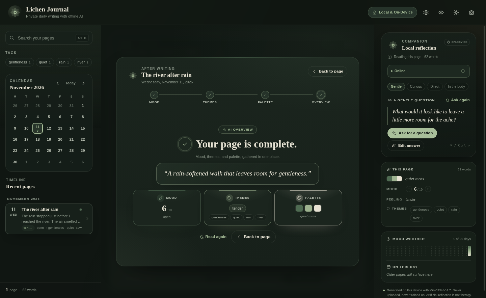
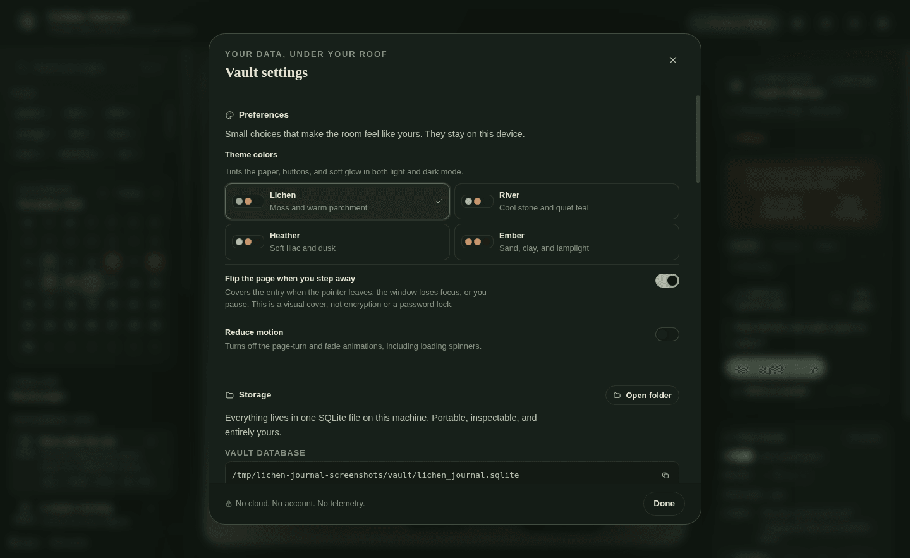
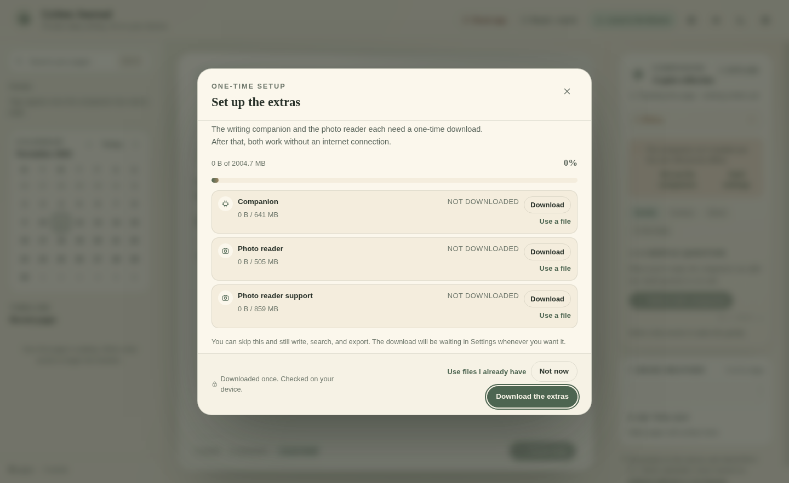
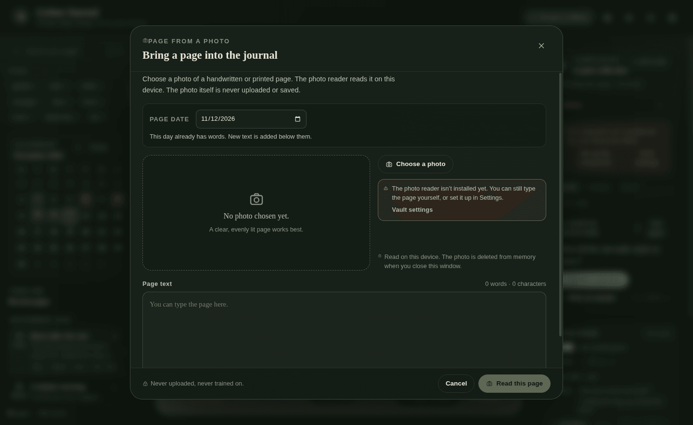

# Lichen Journal

> **Development status:** Lichen Journal is currently in development and is
> undergoing a lot of changes. Features, storage details, and packaging may
> change before a stable release.

**Private daily writing. Everything you write stays on your device. No subscriptions.**

Lichen Journal is a desktop daily journal with a local SQLite vault, instant
full-text search, and a small language model that offers one gentle reflection
at a time — all running on the same machine, with no accounts and no cloud.



<p align="center">
  <strong><a href="https://tarlow.itch.io/lichen-journal">Download or support Lichen Journal on itch.io →</a></strong>
</p>

<p align="center">
  
  
</p>

## What makes it different

- **One local file.** Every entry lives in `vault/lichen_journal.sqlite` under
  the app's data directory. You can find it, inspect it, export it, or erase it.
- **Offline after setup.** Model weights are not bundled. You download them once
  from Hugging Face on first run; after that, packaged builds cancel every other
  HTTP(S), WebSocket, and DNS request at the Electron session layer. There is no
  telemetry, account, sync, update channel, remote font, or analytics SDK.
- **A companion, not a ghostwriter.** MiniCPM-V 4.7 1B is used only for a
  reflection question, extracted metadata, and an emotional color palette. It
  never writes into your journal body.
- **Processor-first, video card optional.** Windows and Linux run on the
  processor by default and can opt into video-card acceleration during first-run
  setup or in Settings. Apple Silicon uses its graphics chip automatically and
  can be switched to the processor. If a check fails, the companion stays on the
  processor and says so in one plain sentence. No driver setup is required.
- **Yours to remove.** A two-step, typed-confirmation purge clears the database
  and recreates an empty vault. Exports are plain Markdown plus JSON.

## Features

- Daily entries with auto-save, word/character counts, and a close-time flush so
  the last sentence is not lost. A saved page can be deleted from its footer after
  a confirmation dialog; the entry, tags, palette, and saved reflections are
  removed locally.
- **Add a page from a photo.** Choose a photo of a handwritten or printed page,
  read it locally with MiniCPM-OCR, edit the text, and add it to a chosen day.
  Existing words are kept; the new text is added below them. The photo is never
  saved or uploaded.
- SQLite FTS5 search over titles and bodies, with highlighted snippets, prefix
  matching, and combined tag filters.
- Timeline grouped by month, a Monday-first calendar colored by mood palettes,
  and an AI-read mood shown on a 1–10 scale in the after-writing overview.
- **Finish page** turns the page into a centered after-writing overview. The
  companion reads the mood, themes, and palette one step at a time, then leaves a
  combined AI overview. The mood is AI-picked and adjustable before the palette.
  Once all three stages are settled, the editor shows a **Page finished** status
  and a separate **Review** button. Review opens the final overview (step four)
  with the saved reading, without re-running the companion; **Read again** on the
  overview is the explicit opt-in to re-analyze the page. Switch back at any
  time; the overview stays ready until the page changes.
- Privacy page-turn: when the pointer leaves the center page, when you pause
  with the caret still in the editor, or when the app loses focus, the entry
  turns over to a resting cover. Hover, focus, or type to turn it back. This is
  a visual cover, not encryption or a password lock, and it can be switched off
  in Preferences.
- An eye button in the header opens **minimal writing mode**: the sidebars,
  page heading, counters, footer actions, and saved reflections step away,
  leaving the title and body. Escape or the eye returns. The privacy page-turn
  keeps working in minimal mode.
- Local AI companion:
  - `ai:reflect` — one compassionate follow-up question, streamed token by token.
  - `ai:extract-metadata` — prefixed JSON with tolerant local parsing: summary,
    tags, mood, emotion, and the sentence numbers that anchor the reading.
  - `ai:mood-palette` — a three-color palette and a short vibe name.
  - Four quiet angles for the next question — gentle, curious, direct, in the
    body — with the last choice remembered on this device. An angle only changes
    what the companion notices; it never loosens the rules.
  - The rail says what it is reading (`Reading this page · 84 words · unsaved
    changes`), so the question is never a surprise.
  - The previous page's open question can be carried forward. **Ask again** reads
    today's entry next to it without writing the borrowed question into today's
    page; **Let it go** hides it. It disappears on its own once today has a
    reflection.
  - The companion status pill says Online or Offline at a glance; its round info
    button reveals the backend, thread count, and model size on hover or focus.
  - Streamed and saved reflections are stripped of chat tokens and stray model
    tags, so only the question reaches the panel.
  - When a question arrives, a gentle answer box opens. Saved answers are nested
    at the bottom of that page with a toast confirmation; you can reopen and edit
    one later, and asking again keeps earlier answered questions intact.
- The **This page** card in the rail keeps the current page's palette, mood, emotion
  and themes in view. Mood can be nudged with quiet − and + steppers, and the
  theme chips filter the journal the same way the sidebar does. When the
  companion grounded its reading in specific lines, they appear as short quoted
  anchors under *Lines*. Whatever the companion has not read yet says *Not read
  yet* rather than guessing, and a reading that fell back to local values says so
  and offers **Read again**. A tint chosen locally is labelled *local tint*.
- Saved palettes frame the page with a full accent border and a stronger
  ambient glow, so even pale tints remain visible.
- The **Journal** card shows the last three weeks as mood-colored ticks, with dashes
  where nothing was written, and surfaces the pages from a month and a year ago.
  Both cards are read straight from the vault and double as shortcuts back to
  those pages.
- Preferences in Vault settings: four theme color palettes (Lichen, River,
  Heather, Ember), the privacy page-turn on/off, reduced motion, and a
  **Faster answers with my video card** switch where the platform supports it.
  Choices stay on this device.
- Vault settings with preferences, absolute paths, copy buttons, per-model
  download state, ZIP export, offline self-check, and vault purge.
- Warm parchment / earthy slate / sage light theme and a forest-dark theme.
- No external fonts or images. The window works from a single local bundle.

## Requirements

- Windows 10/11 (x64), macOS 12+ (Intel or Apple Silicon), or Linux x64.
- 6 GB RAM minimum; 8 GB recommended. The companion uses roughly 0.8 GB while
  loaded, and a photo read adds roughly 1.4 GB in a separate process.
- About 0.6 GB for the application itself on Windows/Linux x64 (the video-card
  runtimes add roughly 100 MB), plus about 2.0 GB for the downloaded model files
  (first run or Settings).
- Internet is needed once to download the models. After that, the app works
  without a connection; photo pages also need their model files downloaded.

## Quick start

```bash
npm install
npm run dev
```

The development server runs on `127.0.0.1:5173`; port 5173 must be free. In
development the only network exceptions are the local Vite dev server/HMR
connection and the explicit model download. Packaged builds have only the model
download.

If Electron aborts on Linux with a `SUID sandbox helper` error, use
`ELECTRON_DISABLE_SANDBOX=1 npm run dev` for local development (see
[Troubleshooting](#troubleshooting)); do not ship builds that rely on it.

Other useful commands:

```bash
npm test                 # Vitest: vault, FTS, export, purge, ritual, AI normalization
npm run build            # Renderer bundle into dist/
npm run dist:dir         # Unpacked app for the current OS
npm run dist             # Installer/AppImage for the current OS
npm run smoke:ai         # Direct companion smoke test (reflection + metadata + palette)
npm run smoke:ai:gpu     # Companion smoke on a host with a working video card
npm run smoke:ocr        # Direct OCR smoke test on tests/fixtures/ocr-journal-page.png
npm run selftest         # Electron end-to-end vault/AI/OCR/export/purge self-test
npm run model:verify     # Verify the three development GGUF files
npm run ocr:runtime:fetch   # Download the pinned processor and video-card OCR runtimes
npm run ocr:runtime:verify  # Verify the bundled OCR runtimes start
```

### Model files

The app ships no GGUF files. On first run it downloads:

```
<userData>/models/MiniCPM-V-4_7-1B-Q4_K_M.gguf
<userData>/models/MiniCPM-OCR-1_0-Q4_K_M.gguf
<userData>/models/mmproj-model-f16-4x.gguf
```

The download is pinned to the Hugging Face URLs and SHA-256 values in
[`src/main/model-catalog.js`](src/main/model-catalog.js), and is verified before
use. Downloads can be resumed, cancelled, or replaced with files you already
have. Settings shows the exact paths and per-file status.

The OCR `llama-mtmd-cli` runtimes are bundled: a processor build on every
platform, plus a Vulkan build under `gpu/` on Windows/Linux x64. They live under
`vendor/llama/<platform>-<arch>/` in development and `<resources>/llama/` in a
packaged build. The companion's video-card backend is the matching prebuilt
`node-llama-cpp` package (Vulkan on Windows/Linux x64, Metal on Apple Silicon).

For development, tests, and smoke runs, the repository `models/` directory can
be populated:

```bash
npm run model:fetch
npm run model:verify
```

The GGUFs in `models/` are ignored by git. See [models/README.md](models/README.md)
for sources, hashes, and Apache-2.0 attribution.

## Where your journal lives

The app uses Electron's `app.getPath('userData')` directory, named **Lichen
Journal**:

| Platform | Vault database |
| --- | --- |
| Windows | `%APPDATA%\Lichen Journal\vault\lichen_journal.sqlite` |
| macOS | `~/Library/Application Support/Lichen Journal/vault/lichen_journal.sqlite` |
| Linux | `${XDG_CONFIG_HOME:-~/.config}/Lichen Journal/vault/lichen_journal.sqlite` |

The vault uses SQLite WAL mode, so `-wal` and `-shm` files may sit beside the
database while the app is open. For backups, prefer the built-in **Export vault
to ZIP** command over copying a live database.

The database is **not encrypted**. Lichen Journal relies on your operating
system account and disk encryption for at-rest protection. The Settings panel
says so plainly.

## Export and purge

**Export** writes a ZIP chosen through the native save dialog:

```
README.txt
metadata.json
entries/2026-11-03-river-notes.md
...
```

Each Markdown file has YAML frontmatter (title, date, mood, emotion, summary,
tags, palette, timestamps) and a clean body, followed by a `## Reflections`
section when you have saved answers. `metadata.json` contains the full
machine-readable vault. It includes reflection questions and their saved answers,
the quoted anchor lines, and whether each reading and palette came from the model
or a local fallback.

**Purge** is intentionally awkward: open Vault Settings → *Clear all vault
data* → type `PURGE` → confirm again. The main process verifies the token itself.
It aborts AI generation, checkpoints/drops the tables, closes and unlinks the
database, removes WAL/SHM files, and initializes a fresh vault.

## First-run model setup

Lichen Journal downloads its model weights once, on first launch. The setup
window lists the companion model and the two photo-page files, shows progress per
file, and supports resume, cancel, and retry.

- **Companion** — ~641 MB, for reflections, metadata, and palettes.
- **Photo reader** — ~505 MB OCR model + ~860 MB vision projector.

You can choose **Not now**. Journaling, search, export, preferences, and vault
management work without any model. The companion rail and Settings keep download
actions available, so setup can be completed later. Once the files are installed,
the app does not use the network for normal operation.

When the files are ready, the same window offers one optional question:
**Want faster answers?** Windows and Linux select the processor by default;
Apple Silicon selects its graphics chip. Choosing **Use my video card** runs a
short real check — the companion is loaded and asked for a few tokens — and only
then is the choice saved. If the check fails, the app keeps everything on the
processor and says so in one sentence. The choice is also available later as
**Faster answers with my video card** in Settings. On Intel Macs and ARM
Windows/Linux the video-card question is not shown.

The downloaded files live under the app’s user-data directory:

```
Windows: %APPDATA%\Lichen Journal\models\
macOS:   ~/Library/Application Support/Lichen Journal/models/
Linux:   ${XDG_CONFIG_HOME:-~/.config}/Lichen Journal/models/
```

Files already present from an older bundled build or a development checkout are
used directly; they are not downloaded again.



## Pages from photos

The camera button in the header, or **Start from a photo** on an empty day,
opens the photo importer.

1. Pick a day. It defaults to the page you are reading and can be changed in the
   dialog.
2. Choose a PNG, JPEG, or WebP photo of a page.
3. **Read this page** runs MiniCPM-OCR 1.0 on the photo. A processor read
   typically takes 10–30 seconds, depending on the photo and machine; a working
   video card makes it faster. If the video-card read fails, that read is retried
   on the processor automatically and the dialog says so.
4. Review and edit the extracted text.
5. **Add to journal** creates the day's page, or adds the text below the words
   already on that day. Existing text is never replaced.

The photo is read from a temporary normalized copy and is not stored in the
vault. Only the reviewed text is saved. If the OCR model or projector is missing,
the dialog says so, still lets you type the page by hand, and points to the
download in Settings and the first-run setup. OCR is best on a single, evenly lit
page; columns, tables, and handwriting may need corrections.



## The local companion

- Runtime: [`node-llama-cpp`](https://github.com/withcatai/node-llama-cpp) 3.22
  for text, plus a bundled llama.cpp b11901 `llama-mtmd-cli` for photo OCR.
- Model: MiniCPM-V 4.7 1B Instruct, root Q4_K_M GGUF (thinking disabled),
  downloaded on first run and loaded lazily on the first AI action.
- Context: 4096 tokens; entry text is truncated to a safe prompt budget before
  generation.
- Accelerator: a main-process **Faster answers with my video card** preference
  (processor by default on Windows/Linux, Metal by default on Apple Silicon).
  Video-card mode uses the bundled Vulkan prebuilt on Windows/Linux x64 and Metal
  on Apple Silicon. `getLlama` keeps `build: 'never'` and `skipDownload: true`;
  no runtime is ever downloaded. A switch is saved only after a child-process
  probe loads the real model and generates a few tokens. On failure the engine
  reloads on the processor, saves that mode, and tells the user once.
- Processor mode on Apple Silicon uses the Metal prebuilt with `gpuLayers: 0`, so
  every layer stays in RAM without needing a separate CPU-only arm64 binary.
- Threads: up to 8 CPU threads for the processor path to balance speed and system
  responsiveness.
- All generations are serialized. Requests can be cancelled. Reflections stream
  into the companion card and are saved in the vault when complete.
- Reflection answers live in the same local SQLite vault, one row per answered
  question. Saving an answer never edits the entry body, and editing an answer
  updates it in place.
- Each reflection angle is appended to the fixed system prompt as a stance for where
  the model should look; the base rules (one question, no advice, no
  interpretation) are unchanged. An unknown angle falls back to gentle.
- Carried questions are passed as a quoted previous question and capped at 400
  characters. The model is told to ask something different; today's entry is
  never rewritten and the borrowed question is never stored in it.
- The This page and Journal rail cards never invoke the model on their own. They
  read saved metadata and two dated lookups, so they stay useful while the
  companion is offline, loading, or busy. The one model action these cards offer
  is **Read again** on a fallback reading, which is an explicit opt-in into the
  overview's reading ritual.
- Metadata and palettes use prompt-prefixed JSON plus tolerant local field
  extraction and strict validation; malformed model output still falls back to
  safe local summaries/palettes. Each
  reading records whether it came from the model or from that fallback, and each
  palette records whether it was painted or chosen locally. The vault keeps that
  provenance and the JSON export carries it, so the rail can admit a fallback
  rather than presenting a guess as a reading.
- Sentence anchors are chosen by number, not written by the model. The metadata
  pass numbers the entry's sentences, the model replies with one to three
  numbers, and the main process quotes those exact sentences. An index that is
  out of range, repeated, or paired with unusable metadata is dropped.
- AI and OCR failures never block journaling. Missing model files leave every
  non-model feature fully usable, show the expected paths in Settings, and offer
  the download again.

AI is a reflective journaling aid, not a therapist, diagnostician, or crisis
service. The model can be wrong or tone-deaf. Do not rely on it for decisions.

## Privacy and security architecture

Packaged builds enforce defense-in-depth:

- `session.defaultSession.webRequest.onBeforeRequest` allows only local
  `file:`, `data:`, `blob:`, `about:`, and `devtools:` requests and cancels
  every other request.
- Packaged builds also add `host-resolver-rules=MAP * ~NOTFOUND` and disable
  background networking, component updates, sync, domain reliability, pings, and
  network prediction. These Chromium switches do not apply to the dedicated Node
  model downloader, which is the explicit exception below.
- The production CSP blocks remote scripts, styles, fonts, images, frames,
  workers, forms, and all `connect-src` traffic.
- Renderer: `sandbox: true`, `contextIsolation: true`, `nodeIntegration: false`,
  `webviewTag: false`, permissions denied, navigation and new windows blocked.
- Preload exposes a small, explicit `window.lichen` API; entry text is only
  rendered as React text, never as raw HTML.
- The AI runtime is configured with `build: 'never'` and `skipDownload: true`, and
  the OCR executable is a bundled file; neither can fetch binaries or models on
  its own.
- The only network client is the explicit model setup downloader in the main
  process. It is pinned to Hugging Face HTTPS URLs, capped at known byte sizes,
  and verified by SHA-256 before installation. It starts only when you press a
  download button. The renderer has no network path.
- Photos are read into a temporary `0600` PNG, passed to the local OCR process,
  and deleted before the request returns. Only the reviewed text is written to the
  vault. The original photo is never copied into the journal.
- There is no updater, crash reporter, account, telemetry, or remote content. The
  app loads no remote fonts or images.

Development has one extra exception: unpackaged builds may talk to the local Vite
server at `127.0.0.1:5173` for HMR.

**Honest limits:** this is strong application-level isolation, not a formal
security audit or an OS sandbox for the entire app. A local process or someone
with your OS account can read an unencrypted SQLite file. Use full-disk
encryption and a locked screen if your journal needs protection from other
people with access to the device.

## Working in this repository

Agents follow [`AGENTS.md`](AGENTS.md) for the commit-after-task and explicit-push-only workflow, verification matrix, and repository invariants.

## Architecture

```
src/main/index.js       Electron lifecycle, windows, IPC, air-gap, close flush
src/main/security.js    Session request blocking, navigation hardening, offline probe
src/main/db.js          SQLite vault, FTS5, markdown export, transactional purge
src/main/ai.js          node-llama-cpp engine, queue, streaming, persistence hooks
src/main/ai-prompts.js  System prompts and structured-output prompts
src/main/ai-utils.js    Output validation, tolerant parsing, deterministic fallbacks
src/main/model-catalog.js  Pinned model URLs, sizes, and hashes
src/main/model-manager.js  Download queue, resume, checksum, import, status
src/main/ocr.js         llama.cpp OCR process, queue, cancellation, errors
src/main/ocr-utils.js   OCR arguments, text cleanup, page merge, path resolution
src/main/preload.js     Context-isolated window.lichen bridge
src/main/selftest.js    Packaged-mode end-to-end verification
src/renderer/           React 19 + Vite UI (Editor, PhotoImportModal, companion rail)
tests/                  Vitest unit/integration tests
e2e/                    Playwright Electron tests
```

Main and preload stay unbundled CommonJS so native modules and asar unpacking
remain reliable. `node-llama-cpp` is loaded with a dynamic `import()` because the
package is ESM-only. The renderer is a normal Vite/React build.

## Testing

```bash
npm test
```

Unit/integration coverage includes:

- date/tag validation and word counting;
- entry CRUD, deletion and orphan cleanup, partial autosave updates, stats, reopen
  behavior;
- FTS5 title/body/prefix/multi-term search, snippets, malformed syntax, tag AND
  filters, limits, and LIKE fallback;
- metadata/tag transactions and orphan cleanup, palettes, reflection questions and
  saved answers;
- ZIP export contents/frontmatter/metadata, reflection answers, empty exports,
  purge/re-init;
- AI output cleanup, tolerant parsing of loose JSON, clamping, and deterministic
  fallbacks;
- model catalog/path precedence, multi-file download queues, resume, cancellation,
  checksum failure, and folder import;
- OCR text cleanup, runtime arguments, page merging, and runtime path resolution;
- performance settings, platform capabilities, probe output/timeout handling, the
  GPU-to-processor fallback controller, and non-technical error messages;
- after-writing overview stage completion, including the difference between a
  stored palette and a fallback tint.

Playwright tests build the renderer first:

```bash
npm run build
xvfb-run -a npm run test:e2e
```

On a normal desktop, omit `xvfb-run`. The E2E suite covers first launch,
close-time flush, persistence across relaunch, search highlighting, mood,
theme persistence, absolute vault paths, ZIP export, air-gap self-check,
double-confirmed purge, saving and editing a reflection answer (the answer box,
success toast, and nested page section), deleting a page after confirmation,
minimal writing mode, the palette accent frame, the Finish page after-writing
overview (mood/themes/palette/final, the finished status, and Review opening step
four with saved data), Preferences (palette, page-turn, reduced motion, the
video-card switch where available, persistence), the privacy page-turn, adding a
page from a photo into a page that already has words, the first-run model setup
with journaling after “Not now,” and the optional performance question with the
processor path. On headless Linux CI,
tests launch Electron with `--no-sandbox --disable-gpu --user-data-dir=…` and
`ELECTRON_OZONE_PLATFORM_HINT=x11`.

### Development reset controls

When the app runs from source, the header includes two developer-only reset
buttons. They are not present in packaged builds, and both ask for confirmation
before changing anything.

- **Reset app** clears every entry, theme and preference, the saved compute
  setting, and the downloaded model files. The next screen is the first-run
  setup, exactly as on a new install. In development the deleted GGUFs live in
  the repository `models/` directory, so restore them with `npm run model:fetch`
  or download them again from first-run setup.
- **Reset + mock** clears every entry and resets theme/preferences, but keeps
  the downloaded models and the saved compute setting. It then seeds eight demo
  entries relative to today so the calendar, companion rail, Finish page, and
  reflection answers can be exercised without typing.

Packaged smoke test:

```bash
npm run dist:dir
xvfb-run -a env LICHEN_SELFTEST=1 \
  LICHEN_USER_DATA_DIR="$(mktemp -d)" \
  release/linux-unpacked/lichen-journal --no-sandbox --disable-gpu

# Exercise the optional AI and OCR paths against the development models.
xvfb-run -a env LICHEN_SELFTEST=1 \
  LICHEN_USER_DATA_DIR="$(mktemp -d)" \
  LICHEN_MODEL_DIR="$PWD/models" \
  release/linux-unpacked/lichen-journal --no-sandbox --disable-gpu
```

With the development models present, the self-test verifies the companion and
OCR files, SQLite/FTS, ZIP export, one real reflection and its saved answer,
metadata, palette, one real local OCR read, the network block, and purge/re-init.
Without model files it verifies the vault/export/network/purge and runtime, and
records that the optional model checks were skipped. A packaged release check can
point at the development models with `LICHEN_MODEL_DIR="$PWD/models"`. It prints
a `LICHEN_SELFTEST_RESULT` JSON object. When
`LICHEN_USER_DATA_DIR` is not set, the self-test creates an isolated temporary
app-data directory, so it cannot touch a real journal.

## Building a release

Build on the target OS. `node-llama-cpp` does not support cross-compiling its
native binaries.

```bash
npm ci
npm run ocr:runtime:fetch
npm run dist:win     # Windows NSIS installer (on Windows)
npm run dist:linux   # Linux AppImage (on Linux)
npm run dist:mac     # macOS dmg + zip (on macOS)
```

Artifacts appear in `release/`. `electron-builder.json` bundles the OCR runtime
under `vendor/llama/<platform>-<arch>/` (and its `gpu/` subfolder on Windows/Linux
x64), plus the matching prebuilt `node-llama-cpp` backend; no GGUF files are
included. The packaged app downloads model weights on first run. Native modules
are asar-unpacked, and user data is kept on uninstall
(`deleteAppDataOnUninstall: false`).

The unpacked app is roughly 0.6 GB on Windows/Linux x64 including native modules,
the Vulkan backends, and the OCR runtimes; the models add about 2.0 GB in user
data after setup. Windows/macOS builds are unsigned by default: code
signing/notarization is strongly recommended. See [docs/release.md](docs/release.md)
for the release checklist, artifact checks, and signing notes.

## Configuration reference

| Variable | Purpose |
| --- | --- |
| `LICHEN_USER_DATA_DIR` | Test/dev override for app data. Used by E2E and packaging checks. |
| `LICHEN_ENABLE_GPU=1` | Re-enable Chromium hardware acceleration for the interface (off by default for stability). This does not control whether the AI models use a video card; use the in-app preference for that. |
| `LICHEN_COMPUTE_MODE=cpu\|gpu` | Test/dev override for the model accelerator. The saved in-app preference is authoritative in normal use. |
| `LICHEN_REQUIRE_GPU=1` | Make the GPU smoke checks fail if the video card was not actually used. |
| `LICHEN_DEVTOOLS=1` | Allow DevTools in packaged builds for debugging. |
| `LICHEN_SELFTEST=1` | Run the packaged self-test and exit. |
| `LICHEN_MODEL_DIR` | Test/dev override for the directory containing model files. |
| `VITE_DEV_SERVER_URL` | Set by the dev script; loads the Vite renderer. |

## Troubleshooting

**`npm install` warns that install scripts were skipped**  
`package.json` contains `allowScripts` approvals for `node-llama-cpp`,
`better-sqlite3`, `esbuild`, and `electron-winstaller`. Use npm 11+ or run
`npm install-scripts approve --all` after reviewing. Then
`npm rebuild node-llama-cpp`.

**`NODE_MODULE_VERSION` / native module error**  
`better-sqlite3` ships Node-API prebuilds. If a local version is broken:
`npm rebuild better-sqlite3`. Do not run `electron-builder install-app-deps`
unless you need it; the builder config sets `npmRebuild: false`.

**“Companion model not installed” / “Photo pages are unavailable”**
Use the download actions in the first-run setup, the companion alert, or Vault
Settings. The app shows the exact user-data paths and per-file download state.
For development, populate `models/` with:

```bash
npm run model:fetch
npm run model:verify
npm run ocr:runtime:fetch
npm run ocr:runtime:verify
```

Settings shows the exact model, projector, and runtime paths. A missing OCR file
disables only the photo importer; the editor and companion still work. On Linux,
the bundled `llama-mtmd-cli` needs its shared libraries beside it; do not copy the
executable out of its platform directory.

**“We couldn’t use your video card”**

The app will keep everything on the processor; your journal, search, export and
photo import still work. Update your graphics software, close other
graphics-heavy apps, and try the switch again in Settings. If it still fails, use
the processor. This is a performance choice, not a setup requirement. On Apple
Silicon the graphics chip is the default; Intel Macs and ARM Windows/Linux do not
show the switch.

**The photo reader fell back to the processor**

The read succeeded on the processor, which is the supported fallback. The dialog
says so. The companion may still be using the video card; only that photo read
was retried.

**Model download fails, stalls, or checksum is rejected**
Use **Retry** in the setup window or Settings. Partial downloads resume from the
`.part` file. A checksum failure discards the bad part; try again. If Hugging
Face is unreachable, use **Use files I already have** and point the folder picker
at a folder containing the three expected filenames. The app never installs an
unverified model.

**A photo produces empty or garbled text**
Use a single, evenly lit page with the text filling most of the frame. Very small
handwriting, columns, and tables may need editing. The extracted text is always
shown for review before it is added, and you can type over it.

**Electron aborts with a `SUID sandbox helper` error on Linux**  
Chromium's `chrome-sandbox` helper must normally be root-owned with mode `4755`
on a filesystem that allows setuid. Some checkouts (including a `nosuid` mount)
cannot provide that. For local development only, disable the OS-level sandbox:

```bash
ELECTRON_DISABLE_SANDBOX=1 npm run dev
```

This is Electron's equivalent of `--no-sandbox`; the app's renderer isolation
settings remain in place, but Chromium's OS sandbox is off. Do not ship a build
that depends on it. The E2E suite already passes `--no-sandbox` explicitly.

**Blank window on headless Linux/CI**  
Electron needs a display. Use `xvfb-run -a`, `ELECTRON_OZONE_PLATFORM_HINT=x11`,
and `--no-sandbox --disable-gpu`. These flags are for headless testing only; do
not ship a desktop build that requires them.

**Windows SmartScreen / macOS Gatekeeper**  
Both warn on unsigned apps. Sign Windows installers with an EV/OV certificate
and notarize macOS builds for public distribution.

**Port 5173 is already in use**  
Stop the other process, or temporarily change the port in `vite.config.mjs` and
the `dev`/E2E launch URL.

## Known limitations

- One entry per local calendar day.
- English UI and English-oriented prompts; local dates follow the machine's time
  zone and weeks start on Monday.
- FTS uses SQLite's `unicode61` tokenizer; languages without spaces may have
  different search behavior.
- No encryption, password lock, sync, mobile app, or auto-update.
- There is no bulk entry management; pages are deleted one at a time from the
  editor footer. The whole vault can still be exported or purged.
- The 1B companion is intentionally small. It can produce bland, repetitive, or
  inaccurate language; reflection questions and the answers you save stay with the
  page so you can ignore, reread, or edit them.
- Photo OCR is a convenience, not a transcription guarantee. Handwriting, dense
  tables, columns, and low-light photos may need correction. The original photo is
  not kept in the vault.
- The photo importer adds one page for a chosen day; it does not create multiple
  pages for the same day.
- The first run needs an internet connection to download model weights unless you
  import files you already have. Journaling works without them; AI and photo pages
  do not until the files are installed.
- Windows and macOS builds need verification on those operating systems; this
  repository's end-to-end and packaged smoke tests were run on Linux x64.

## License

Lichen Journal is free and open-source software licensed under the
**GNU General Public License, version 3** (GPL-3.0-only). The full license text is
in [LICENSE](LICENSE). Third-party components and the downloaded MiniCPM models
retain their own licenses; see [THIRD_PARTY_NOTICES.md](THIRD_PARTY_NOTICES.md)
and [models/README.md](models/README.md).

If you find the project useful, you can also
[buy or support it on itch.io](https://tarlow.itch.io/lichen-journal).
